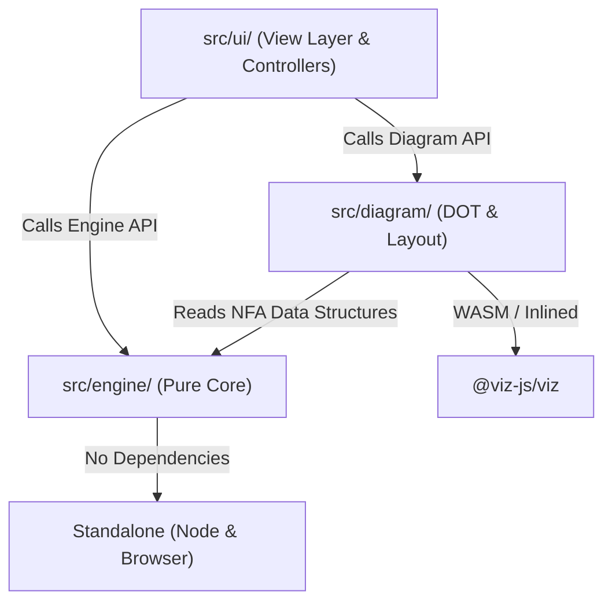

# Architecture Guide

## Overview

The **RE → NFA (Thompson) Simulator** is a high-assurance educational workbench and regular expression engine designed to run entirely client-side. The application compiles regular expressions into non-deterministic finite automata ($\varepsilon$-NFAs) using Thompson's construction, animates each construction step with stable Graphviz layout coordinates, simulates string execution with $\varepsilon$-closure traces, and formally verifies its own construction against structural invariants and differential oracles.

The system is delivered as a single, self-contained HTML bundle (`dist/index.html`) that executes completely offline over `file://` with zero external network requests or server backends.

---

## Architectural Principles & Seams

The codebase enforces strict separation of concerns across two primary public seams:

### 1. Engine Seam (`src/engine/index.ts`)
- **Zero DOM / UI Dependencies**: Pure TypeScript that runs identically under Node.js and in modern browser environments.
- **Data Immobility & JSON Serialization**: Engine functions return plain JSON-serializable objects. Construction step records store copies rather than live object references.
- **Lexing, Parsing, and Transformation**:
  - `lexer.ts`: Lexical analysis supporting standard (`|`, `*`, `+`, `?`) and textbook (`+`, `*`, implicit concatenation) regular expression notations with code-point error tracking.
  - `parser.ts`: Recursive descent parser producing structured AST nodes and postfix operator streams.
  - `builder.ts`: Modular Thompson fragment compiler supporting both canonical $\varepsilon$-link concatenation and state-merging concatenation.
  - `nfa.ts` & `simulation.ts`: Thompson $\varepsilon$-closure computation, subset construction stepping, and string acceptance matching.
  - `invariants.ts`, `suite.ts`, `differential.ts`: Formal verification checking structural invariants $I_1$–$I_4$, size formulas, step replay, and differential testing against independent oracles (string enumerator, Brzozowski derivatives, JavaScript RegExp).

### 2. Diagram Seam (`src/diagram/index.ts`)
- **Engine-to-DOT Bridge**: Converts NFA graphs and AST parse trees into Graphviz DOT syntax (`toDot`).
- **Stable Pinned Layouts**: Implements a master layout calculation algorithm (`computeMasterLayout`) that extracts node coordinates from the final NFA and pins them (`splines=true;`) across intermediate construction steps to eliminate visual node jumping.
- **WASM Graphviz Integration**: Wraps Viz.js via `VizRenderer` to safely execute Graphviz layouts client-side.
- **Stress Visualization**: Renders benchmark comparison charts as vector SVG with logarithmic and linear scaling (`renderStressChartSvg`).

### 3. UI View Layer (`src/ui/`)
- **Algorithmic Decoupling**: The view layer performs no algorithmic automata work; it solely renders representations returned by the Engine and Diagram seams.
- **Modular Controllers**: High-complexity subsystems are encapsulated in cohesive view controllers with explicit entry points and dependency injection:
  - `stress-controller.ts`: Manages polynomial vs exponential backtracking benchmarks, background Web Worker timeouts, cancellation, CSV export, and SVG chart download.
  - `validation-view.ts`: Manages the formal validation metric strip, built-in 24-case test suite execution, and differential oracle testing.
  - `viewport.ts` & `canvas-touch.ts`: Handles hardware-accelerated pan/zoom transforms, touch gestures, and pointer capture.
  - `router.ts`: Client-side hash routing across `#workbench`, `#validation`, and `#stress` views.

---

## Web Worker Architecture

To guarantee UI responsiveness during computationally expensive operations, backtracking comparisons and RegExp differential testing are isolated into an inline Web Worker (`src/ui/worker.ts`):
- Inlined into the production bundle using Vite's `?worker&inline` mechanism to avoid browser security restrictions when loaded over `file://`.
- Features strict timeouts (2,000 ms for differential testing, 8,000 ms for stress testing) to prevent pathological regex backtracking from blocking the browser thread.
- Full mutual exclusion between differential testing and stress benchmarks to eliminate resource contention.

---

## Testing Strategy & Quality Gates

The simulator follows rigorous test-driven verification across multiple testing tiers:

1. **Unit & Property Tests (Vitest + Fast-Check)**:
   - 205 unit tests covering tokenization, parsing, fragment construction, graph layout, viewport mathematics, URL encoding, and CSV generation.
   - Property-based tests verifying agreement across language oracles and state/transition size formulas.
2. **End-to-End Browser Tests (Playwright)**:
   - 792 assertions verifying visual stability, DOM accessibility, stepper animations, touch gestures, deep linking, and single-file bundling over `file://`.
3. **Mutation Gate Testing**:
   - `tests/mutation-gate.cjs`: Evaluates 13 canonical engine mutants targeting parser, builder, invariant, and simulation routines (100% kill rate required).
   - `tests/ui-mutants.cjs`: Evaluates UI behavior and regression mutants against Playwright and Vitest runners.
